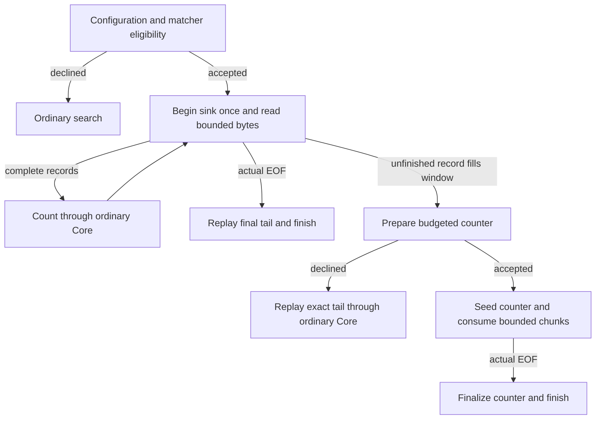

# Search Algorithms

## Owners and call paths

Grep uses the C-byte BRE/ERE mechanisms in [core/bytere](../../core/bytere/).
Rg uses its separate leftmost-first engine in
[internal/regex](../../commands/rg/internal/regex/). Their syntax, captures and
selection rules are not interchangeable. [ADR-0008](../adr/0008-data.md) owns
that semantic decision; [upstream-baselines.md](../upstream-baselines.md)
records imported-source provenance.

Rg's [SearchWorker](../../commands/rg/internal/driver/search.mbt) selects the
input and printer, optionally wraps a regular file in
[FileReadBuffer](../../commands/rg/internal/driver/file_read_buffer.mbt), then
calls [Searcher::search_reader](../../commands/rg/internal/searcher/searcher.mbt)
with the private [SearchMatcher](../../commands/rg/internal/driver/search_matcher.mbt).
The searcher owns decoding, record lifetime and sink events; the adapter owns
command-specific matcher eligibility. Regex automata and byte kernels do not
import the driver.

Grep's [execution plan](../../commands/grep/execution.mbt) selects full output,
span output or summary behavior before its
[streaming loop](../../commands/grep/streaming.mbt). Required context, binary
detection, selected-line accounting and early exits remain command-owned.

## Negative filters and exact engines

| Mechanism | Admission and benefit | Required fallback or cost |
| --- | --- | --- |
| Adaptive literal set | Bounded literal sets select shift search or Aho–Corasick; density probes can change the equivalent search path | Outside construction limits, use the ordinary matcher; offsets and captures still follow their owner |
| Mandatory literal | A necessary byte sequence can reject an impossible record before text conversion or full matching | A hit is only a candidate; nullable, uncertain and unsupported patterns retain the full engine |
| Boolean record DFA | Supported patterns answer whether a record matched without retaining spans/captures | Construction budgets and assertion restrictions can decline the plan; preserve ordinary semantics |
| Anchored linear plan | A restricted anchored shape avoids general search setup | General one-pass matching remains a rejected control; resemblance to the accepted shape is insufficient |
| Wide byte scan | Exact membership/transition summaries skip bytes that cannot change the result | Short or dense regions use the ordinary transition loop; heuristic rejection never invents a match |

Owners: [literal planning](../../core/bytere/literal_set.mbt),
[record DFA](../../core/bytere/record.mbt),
[anchored plan](../../core/bytere/record_linear.mbt),
[byte membership](../../core/bytesearch/byte_membership.mbt), and
[rg record machines](../../commands/rg/internal/regex/automata/record_boolean.mbt).
Bounded automata give linear scanning for an admitted fixed machine; this is
not a complexity guarantee for general backreferences or every regex query.

## Rg streaming counts and replay

[Literal counting](../../commands/rg/internal/searcher/count_stream.mbt) retains
only the necessary suffix for an eligible delimiter-excluding literal. Other
eligible patterns enter [regex counting](../../commands/rg/internal/searcher/count_regex_stream.mbt):

Complete short records avoid counter construction. An early match or a preceding
short record does not disqualify a long record. The matcher still rejects
unsupported assertions and configurations; multi-byte mandatory-literal
filtering can keep the whole-record path until the streaming cursor supports
that filter. A full input window is never treated as EOF.

The counter carries automaton state across reads and emits only completed
record results. Failed construction reuses the decoded tail and existing Core,
without a second sink begin. A later read error preserves completed counts but
does not finalize the unfinished record. Accepted count paths use bounded
input storage; declined plans may retain the longest record.

On reader-search exit, [buffer retirement](../../commands/rg/internal/searcher/searcher.mbt)
releases line/multiline allocations above 1 MiB, including after errors.
This limits retained exceptional buffers between searches, not active fallback
records, multiline input, allocator retention or total process RSS.

## Cache, file and output lifetime

NFAs compile eagerly so syntax/size errors and group metadata retain their
timing. Non-raising reverse/capture storage is prepared lazily. Unproductive
lazy-DFA pressure can retire the cache and restart the original query through
PikeVM; Unicode quits are a different condition. See
[prepared storage](../../commands/rg/internal/regex/prepared.mbt) and
[cache policy](../../commands/rg/internal/regex/automata/cache_policy.mbt).

Regular-file read-ahead grows after full physical reads and delivers cached
bytes before a pending read error. Stdin, preprocessing and early-exit modes
retain their own paths. Complete plain output records may enter the existing
buffer atomically; declining admission changes neither output nor statistics.
Multiline, styled, oversized and line-buffered output preserves ordered handling.

## Evidence and useful follow-ups

The `c4ea779` macOS comparison qualifies all 15 registered rg rows. On the
complete SQLite source interpreted as one NUL-delimited record, regular and
fragmented count time falls about 11–12% against the original audit baseline.
Separate synthetic 32 MiB early-match diagnostics reduce peak RSS from about
98 to 34 MiB; they do not establish a general memory bound or regex speedup.

Use the `rg-*`, `grep-*`, `bytere-*` and `exact-byte-membership` strategy entries
in [protection.json](../../tests/benchmark/protection.json) for exact tests and
real workloads. Preserve early/late/missing matches, prefixes, fragmented
delimiters, unsupported assertions, construction failures and event traces.

Revisit broader count admission only with a streaming equivalent of the
required literal filter. Revisit general one-pass matching only with the retained
rejection controls and all dialect/capture semantics. `--dfa-size-limit` needs
real byte accounting and fallback; the compiler's state limit is not its substitute.
